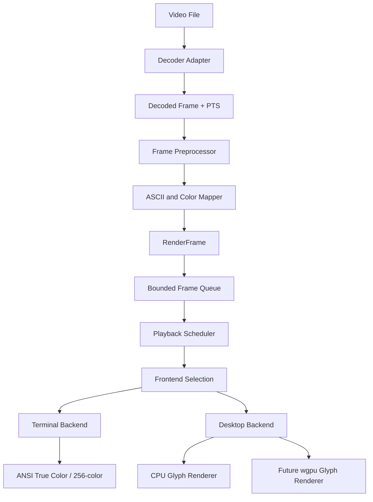
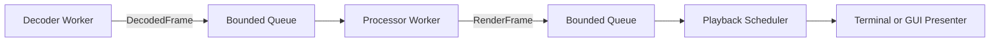

# RGB ASCII Video Renderer — Architecture

> Architecture contract for OpenCode. Preserve the dependency boundaries and data-flow rules in this document. Any material architectural change requires an explicit rationale and documentation update.

## 1. Architectural Overview

The application uses a layered, pipeline-oriented architecture with a shared Rust rendering core and two presentation frontends:

- Terminal frontend: ANSI output through Crossterm.
- Desktop frontend: eframe/egui application shell, with a CPU renderer first and optional wgpu renderer later.

The central design rule is:

**Decode and transform video into a frontend-independent `RenderFrame`; frontends only schedule and present that model.**

Neither frontend may implement its own independent luminance or ASCII conversion algorithm.

## 2. Logical System Diagram



## 3. Workspace and Crate Responsibilities

### `renderer-core`

Owns frontend-independent rendering concepts and algorithms:

- RGB and color types.
- Render cell and render frame models.
- Luminance calculation.
- Character palette mapping.
- Color conversion helpers that are not terminal-specific.
- Frame resize/aspect-ratio policy interfaces.
- Processing configuration.
- Core processing pipeline contracts.

Must not depend on:

- Crossterm.
- egui / eframe.
- wgpu.
- Terminal escape sequences.

### `video-decoder`

Owns video input and decoder adapters:

- Decoder trait/interface.
- FFmpeg subprocess implementation for MVP.
- Process lifecycle and stderr diagnostics.
- Raw frame parsing.
- Frame metadata and timestamps.
- EOF and decoder error mapping.

The decoder boundary must hide whether frames come from a subprocess or native FFmpeg binding.

The subprocess protocol must explicitly define pixel format, dimensions, frame boundaries, and timestamp source. Do not infer frame boundaries from arbitrary pipe reads; raw reads may be partial and must be accumulated correctly.

If the selected FFmpeg invocation cannot reliably provide per-frame PTS through the chosen raw output path, design a robust timestamp side channel or select a different decoding approach. Do not silently assume constant frame rate.

### `terminal-renderer`

Owns terminal-specific presentation:

- Crossterm setup and teardown.
- Terminal dimensions.
- ANSI True Color serialization.
- RGB-to-xterm-256 palette mapping.
- Buffered output.
- Cursor and screen control.
- Keyboard input.
- Terminal resize handling.

It consumes `RenderFrame`; it must not decode video or recalculate ASCII characters.

### `gui-renderer`

Owns desktop presentation:

- eframe / egui application shell.
- File selection and controls.
- Preview surface.
- UI state.
- Runtime statistics display.
- CPU glyph renderer initially.
- Future GPU renderer adapter.

The GUI event loop must remain responsive. Decoder and processing work must happen outside the UI update callback and communicate through channels or another explicit concurrency boundary.

### `apps/cli`

Owns CLI argument parsing, configuration assembly, application startup, and orchestration of decoder, core pipeline, playback, and terminal backend.

### `apps/desktop`

Owns desktop application startup and wiring of GUI, decoder, core pipeline, and playback services.

## 4. Dependency Direction

Allowed high-level dependency direction:

```text
apps/cli ───────> renderer-core
    │            video-decoder
    └──────────> terminal-renderer

apps/desktop ──> renderer-core
    │            video-decoder
    └──────────> gui-renderer

terminal-renderer ──> renderer-core
gui-renderer ───────> renderer-core
video-decoder ──────> renderer-core (shared frame/metadata contracts only)
```

Rules:

1. `renderer-core` is the lowest-level project crate.
2. `renderer-core` must not depend on frontend crates.
3. Decoder implementation details must not leak into frontends.
4. Frontends must not duplicate frame processing.
5. Avoid circular crate dependencies.
6. Keep shared contracts small and stable.

## 5. Core Data Model

The following is conceptual. OpenCode should refine types and ownership based on actual implementation, while preserving semantics.

```rust
#[derive(Debug, Clone, Copy, PartialEq, Eq)]
pub struct Rgb {
    pub r: u8,
    pub g: u8,
    pub b: u8,
}

#[derive(Debug, Clone, Copy, PartialEq, Eq)]
pub struct RenderCell {
    pub character: char,
    pub foreground: Rgb,
    pub background: Option<Rgb>,
}

#[derive(Debug, Clone)]
pub struct RenderFrame {
    pub width: u32,
    pub height: u32,
    pub cells: Vec<RenderCell>,
    /// Presentation timestamp in a documented unit, preferably microseconds
    /// after conversion from the source stream time base.
    pub timestamp_us: i64,
}
```

Invariants:

- `cells.len() == width * height`.
- Cells are stored in row-major order.
- Timestamp units are explicit and consistent.
- RGB values remain raw color values; ANSI codes are not stored in the core model.
- The model must be safe to share across worker and presentation boundaries.
- Avoid unnecessary `Clone` of large frame buffers; use ownership transfer or shared immutable buffers where appropriate.

For variable frame rate, preserve source PTS and time base accurately. Conversion to microseconds must account for the stream time base and rounding.

## 6. Frame Processing Pipeline

Per decoded frame:

1. Validate frame metadata and pixel buffer length.
2. Convert source pixel format to the core's chosen RGB representation.
3. Determine output grid dimensions.
4. Resize or sample to the output grid.
5. Apply terminal cell aspect-ratio correction when terminal output is selected.
6. Calculate luminance per output sample.
7. Map luminance to a character palette.
8. Retain/map foreground RGB.
9. Construct `RenderFrame` with presentation timestamp.
10. Transfer ownership into the bounded queue.

### Luminance

Initial formula:

```text
Y = 0.2126R + 0.7152G + 0.0722B
```

Document whether this operates on gamma-encoded or linear-light values. The initial implementation may use the conventional gamma-encoded approximation, provided the choice is consistent and tested.

### Character mapping

Default palette:

```text
 .:-=+*#%@
```

The palette must be ordered from low visual density to high visual density. Mapping must clamp input to 0–255 and always return a valid palette index.

### Color modes

The core model retains RGB. Terminal backend maps to:

- ANSI 24-bit True Color.
- xterm 256-color palette.

The 256-color conversion algorithm must be deterministic and unit-tested. Document whether it uses nearest-color distance in RGB or a perceptual color space. Start with a simple documented method; optimize only after visual validation.

## 7. Decoder Design

Define a decoder abstraction that can be implemented by subprocess and native backends.

Conceptual interface:

```rust
pub trait VideoDecoder {
    fn metadata(&self) -> &VideoMetadata;
    fn next_frame(&mut self) -> Result<Option<DecodedFrame>, DecoderError>;
}
```

This is illustrative, not a mandatory exact signature. The final API must account for blocking reads, cancellation, seeking, and worker ownership.

### MVP: FFmpeg subprocess

Use an FFmpeg subprocess to reduce initial Rust FFI and linking complexity.

Requirements:

- Verify FFmpeg is installed and executable.
- Capture stderr for diagnostics.
- Define raw output pixel format explicitly.
- Parse exact frame byte lengths.
- Handle partial pipe reads.
- Detect early process exit and non-zero status.
- Avoid deadlocks caused by unread stderr.
- Ensure child process is terminated on cancellation and application exit.
- Establish reliable timestamps. If raw video output does not preserve timestamps, implement a separate metadata/timestamp strategy or revise the decoder choice.

Do not claim VFR-correct playback until timestamp preservation is verified.

### Later: native FFmpeg integration

Evaluate maintained Rust bindings only after the MVP has measurable limitations. Verify:

- FFmpeg version compatibility.
- System library availability.
- Build/link requirements on Arch and Windows.
- Licensing implications of the selected FFmpeg build.
- API maintenance status.

Keep the same decoder abstraction so frontends and core processing do not change.

## 8. Concurrency and Backpressure

Recommended initial stages:

- Decoder worker.
- Frame processing worker.
- Presentation thread (terminal main loop or GUI event loop).

Use bounded channels between stages. Initial queue capacity: 2–3 frames, configurable internally until measurements justify a public setting.

Rules:

- Never use an unbounded channel for full frame payloads.
- Define queue-full behavior.
- Define cancellation and shutdown propagation.
- Prefer low-latency playback over displaying stale frames.
- Drop late frames only according to an explicit scheduler policy.
- Do not spawn a large number of threads on a dual-core target.
- Add Rayon only after benchmark evidence.

Potential flow:



The implementation may combine stages if that reduces overhead, but must preserve bounded memory and clear ownership.

## 9. Playback Scheduler

The scheduler controls when a frame is presented.

Inputs:

- Frame PTS.
- Stream time base or normalized timestamp.
- Playback start instant.
- Playback speed.
- Pause/resume state.
- Current wall-clock time.

Requirements:

- Use monotonic time for elapsed playback measurement.
- Respect variable frame timestamps.
- Rebase the playback clock on resume and speed changes.
- Avoid busy-wait loops.
- Handle late frames explicitly.
- Handle missing or invalid timestamps with a documented fallback.
- End cleanly at EOF.

For playback speed `s`, presentation deadline is based on:

```text
deadline = playback_start + (frame_pts - first_pts) / s
```

The actual implementation must use safe duration arithmetic and correct time-base conversion.

## 10. Terminal Rendering Design

- Use Crossterm for terminal operations.
- Query terminal dimensions and handle resize.
- Render using one or a small number of buffered writes per frame.
- Avoid one `flush()` per cell.
- Avoid redundant color escape sequences by tracking current foreground/background where beneficial.
- Consider full-frame redraw first for correctness; add diff rendering only after measurement.
- Restore cursor, alternate screen, and raw mode through a cleanup guard or equivalent RAII design.
- Handle Ctrl+C and ordinary errors without leaving terminal state corrupted.

The terminal backend must document that actual output FPS depends on terminal emulator throughput and terminal configuration.

## 11. GUI Rendering Design

### Initial CPU path

- eframe / egui owns the application shell.
- Keep UI state and rendering data separate.
- Receive completed frames without blocking the UI thread.
- Avoid one widget per character.
- Use a batched text/glyph rendering approach where feasible.
- If initial implementation uses a simpler CPU path, document its performance limits.

### Future GPU path

- Use wgpu only after the CPU path and shared render model are validated.
- Build or use a glyph atlas.
- Render character instances in batches.
- Upload compact per-cell character/color data.
- Avoid one draw call per character.
- Provide CPU fallback when adapter/device initialization fails.
- Do not require discrete GPU hardware.

GPU rendering is a presentation optimization; decoding and ASCII conversion remain independently measurable.

## 12. Error Handling and Observability

Use typed errors at crate boundaries. Application entry points may add context with `anyhow`.

Use `tracing` for structured events such as:

- Decoder startup and shutdown.
- Video metadata.
- Frame decode failures.
- Queue saturation.
- Dropped frames.
- Processing latency.
- Presentation latency.
- GPU initialization/fallback.

Do not log every cell or every frame at normal log levels. High-frequency diagnostics should be opt-in or sampled.

## 13. Testing Architecture

### Unit tests

- Luminance values and rounding.
- Palette endpoints and intermediate mapping.
- RGB-to-256-color conversion.
- RenderFrame invariants.
- Aspect ratio calculations.
- PTS/time-base conversion.
- Playback deadline calculations.

### Integration tests

- Decode a small known fixture.
- Verify frame dimensions and timestamps.
- Verify EOF handling.
- Verify corrupt/unsupported input errors.
- Verify terminal color serialization.
- Verify GUI worker communication and cancellation where testable.

### Performance tests

Benchmark independently:

- Pixel sampling/resizing.
- Luminance and character mapping.
- RGB cell generation.
- RGB-to-256-color mapping.
- Terminal serialization.
- GUI glyph preparation.

Record hardware, Rust version, FFmpeg version, output dimensions, and benchmark configuration.

## 14. Architecture Decision Records

OpenCode should record material decisions in `docs/decisions/` when useful.

Initial decisions:

- **ADR-001:** Shared core model for terminal and GUI.
- **ADR-002:** FFmpeg subprocess for MVP; native binding deferred.
- **ADR-003:** PTS-based playback scheduling.
- **ADR-004:** Bounded queues and low-latency frame policy.
- **ADR-005:** CPU-first implementation; GPU rendering deferred.

## 15. Architecture Change Rules

Before changing a locked boundary:

1. Explain the current limitation with evidence.
2. Describe at least one alternative.
3. Identify impact on crates, platform support, dependencies, and tests.
4. Ask for approval if the change expands scope or invalidates a locked decision.
5. Update this document and relevant tests after approval.
